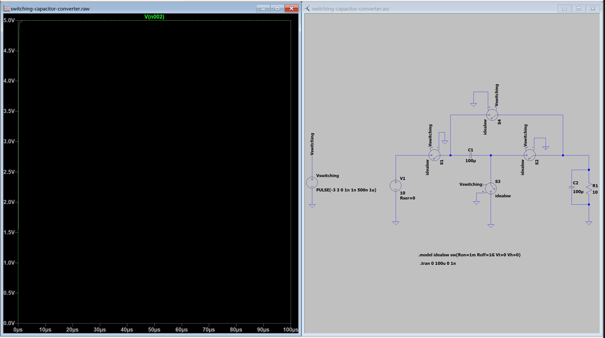

# English Accumulation

- step-up / step-down
- intuit: to know, understand, or perceive something through an inner feeling, instinct, or hunch rather than explicit fact or logic
- hunch: a feeling, intuition that something is true, even when you have no proof or facts
- regime /reɪˈʒiːm/ : a system of norms, rules, decision-making procedures that determine how a goverment is organized, who holds power, and how public offices are accessed

**However, in engineering, "regime" refers to a range of operating conditions, under which a system exihibits a particular behaviour**

for example:
- operating regime
- steady-state regime
- high-frequency regime
- linear regime 线性工作区

- **advance**: to go or bring forward
- advance the clock, advance the date, advance a project 
- preamble: 前言
- `thy years wants wit, thy wits wants edge, and manners` thy: your, wants: lack, wit: wisdom. 你年纪轻轻, 缺乏智慧. 你那点聪明又不犀利, 还缺乏礼数.
- story : in oral English or in tech manual, stroy means situation or how something works, for example: What's the story of this configuration? The whitespace story is the same as with defsrc
- source of truth: truth here means the authorized information source. There's a common expression: SSOT(Single Source of Truth), which means the only trustworthy information source. 
- appointment: 职位任命, 与人的预约
- trailing space
- delimiter: a character or a sequence of characters used to specify the boundary between separate, independen regions of data in atext file...
- interleave: to place layers or pieces of something alternately between another, or to mix different ideas, tasks, or data streams together.

# tasks

- [x] 软件实现短按ctrl->esc, 长按ctrl->ctrl, 实现了, 但是感觉效果不是很好, 不打算用
- emacs
- 今天看完了电力电子

# curl

``` 
* Uses proxy env variable no_proxy == 'localhost,127.0.0.1,::1'
* Uses proxy env variable https_proxy == 'http://172.20.192.1:7892'
*   Trying 172.20.192.1:7892...
* Connected to 172.20.192.1 (172.20.192.1) port 7892 // 这里成功连接到了代理
* CONNECT tunnel: HTTP/1.1 negotiated
* allocate connect buffer
* Establish HTTP proxy tunnel to ergoemacs.org:443
> CONNECT ergoemacs.org:443 HTTP/1.1
> Host: ergoemacs.org:443
> User-Agent: curl/8.5.0
> Proxy-Connection: Keep-Alive
>
< HTTP/1.1 200 Connection established
<
* CONNECT phase completed
* CONNECT tunnel established, response 200
* ALPN: curl offers h2,http/1.1
* TLSv1.3 (OUT), TLS handshake, Client hello (1):
*  CAfile: /etc/ssl/certs/ca-certificates.crt
*  CApath: /etc/ssl/certs
```

# kanata 学习笔记

我知道了, 像是lisp这样的程式结构叫做S-expression S表达式

## comment

use ;; to comment. for example:

``` kanata
;; this is a line of comment
```

multilines comment: use #| to start comment , use |# to end comment, for examle:

``` kanata
#|
this is a multiline comment
another line
|#
```

## defsrc

Your configuration file must have exactly one defsrc list. This defines the order of keys that the deflayer entries will operate on.

syntax:

(defsrc $key1 $key2 ... #keyN)

## deflayer

Your configuration file must have at least one deflayer entry. This defines how each physical key mapped in defsrc behaves when kanata runs.

syntax:

(deflayer $action1 $action2 ... $actionN)

## deflayermap

An alternative method for defining a layer exists: deflayermap. This method maps input to actions by defning input-output pairs, ignoring `defsrc` entirely

syntax:

(deflayermap ($layer-name)
  $input1 $action1
  $input2 $action2
  $input3 $action3
  ...
)

## hold-timeout

Determine whether a key press counts as a tap or a hold. If I release the key before the hold-timeout, its a tap. If I release after the timeout, it's hold

## tap-repress-timeout

Determine whether a repressed key should counts as a tap again or a press. If I press the key before the timeout after I release the same key, the key counts as tap no mater how long I press the key the second time. If I press the key after the timeout, it will be treated as a new key. Same story

折腾了半天, 还是觉得原来的键位最舒服 :), 实际上是怎么都配出来自己理想的效果, 想要复用一个按键必然会引进延迟, 没法按下的瞬间就知道我想要复用功能中的哪一个, 用起来就很难受. 我现在觉得有几个键盘可以改进的空间: 解放左右手分别的spc, 例如左手的大拇指是apc, 然后右手的大拇指是ctrl, 这样, 把最常用的辅助见ctrl放在大拇指处. 以后自己有能力了一定要实现, 不过现在可能就已经有实现方案了, 我上网搜搜

最终决定是使用alt(right) 代替 ctrl(left)

# 电力电子

今天的任务就是看完switched capacitor

wc, switched capacitor 的效果也太好了吧

# markdown

网址语法 `[文字](url)`

# emacs

Xah Lee tutorial of emacs [http://xahlee.info/emacs/emacs/elisp.html](http://xahlee.info/emacs/emacs/elisp.html)

comment: M-:

## comment use ;

## print

- message: print a format string to the message buffer
- insert: insert string to the current buffer at cursor position **not format string**

## variables 

- setq : asign value to variable
- let : create local variable only in the bracket of let

``` elisp
(let ((x 10)
      (y 20))
 (+ x y))
```

- let versus `let*`: with `let*` later bindings can refer to earlier ones.

## fucntion

- defun: define a function
- lambda: create a annonymous function

unlike scheme, elisp has separate namespace for functions and variables

elisp is called lisp2, and scheme is lisp1

## mapcar

## interactive

It turns a normal function into a interactive command, which can be involked by M-x or a key-binding

without interactive, a function can still be called from lisp, but not directly as an ordinary Emacs command.

## key-binding

- global-set-key

``` elisp
(global-set-key (kbd "C-c d") #'my-duplicate-line)
```

## `#'` refer to a function. a short to (function ...)

## hooks : make emacs react to events

## cursor position

emacs treates a file as a continuous text suquence. So, the cursor position is a number instead of a combination of columns and lines

but I can also get the line and soloumn as well.

(line-number-at-pos) returns the line number
(current-column) returns the coloumn number

## print to a buffer

- print  syntax: (print OBJECT &optional TARGET)
- prin1, just like print but no newline at end
- princ, print in more human-readable format (eg. no string delimiters), and no newline at end

## print to warnings buffer

- warn  syntax: (warn FORMAT_STRING &rest ARGS) print a warning of format string ot a buffer named `*Warnings*`

## Temporarily Specify a buffer for output

- with-output-to-temp-buffer syntax: (with-output-to-temp-buffer BUFNAME &rest BODY) bind standard-output to buffer BUFNAME, eval BODY, then show that buffer.

**buffer** is cleared before printing to it.
print functions default to print the buffe
