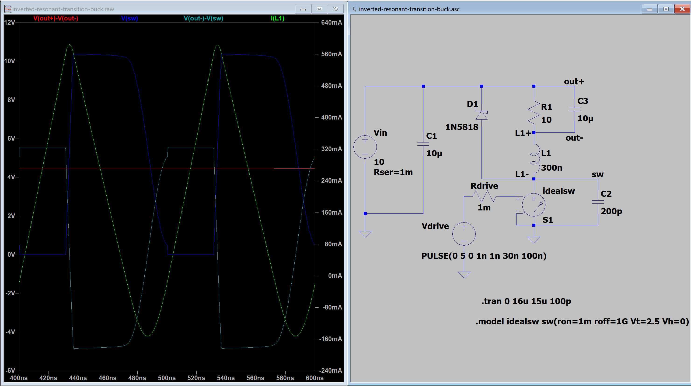

# tasks

- [ ] 看完软开关, 开始看新的一章
- [x] 学习crc
- [ ] Xah Lee

# emacs

## Xah Lee Read File

### ReadFile Content as String or Lines

- read file content into a string

``` emacs_lisp
(defun get-string-from-file (filepath)
  "return file content as string."
  (with-temp-buffer
    (insert-file-contents filepath)
    (buffer-string)))
```

### open file, visible to user, with syntax coloring

- (find-file FILENAME &optioinal WILDCARDS) : creates a new buffer, associate it with filename, switch to the buffer. return the buffer object. [warning] This is user-oriented command, It is very slow, because it has lots of side-effects. for example: 

1. load a major mode, which does syntax coloring, usually very slow
2. record undo for any modification in the buffer.
3. call functions in find-file-hook

## close file

- (kill-buffer &optional BUFFER-OR-NAME) : close current buffer or a specified buffer.

``` elisp
;; close a buffer
(kill-buffer mybuffname)
```

## tommorrow's XAH LEE link

[http://xahlee.info/emacs/emacs/elisp_file_name_dir_name.html](http://xahlee.info/emacs/emacs/elisp_file_name_dir_name.html)

## thins to correct 

evil-settings document [https://evil.readthedocs.io/en/latest/settings.html](https://evil.readthedocs.io/en/latest/settings.html)

- [x] 进入不同的buffer, 需要使用不同的初始模式, 例如**xref**我要使用emacs模式, **help**我要使用evil模式, yeah gocha
- [ ] 不想要阅读代码的时候屏幕下方闪出一大段代码解释
- [x] 实现不同模式下different cursor display

## require function

(require FEATURE &optional FILENAME NOERROR)

If feature is not already loaded, load it from filename.
if feature is not a member of the list 'features', then the feature was not yet loaded; so load it from file filename.

if filename is omitted, the printname of feature is used as the file name, and 'load' is called to try to load the file by that name, after appending the suffix '.elc', '.el', or the system-dependent suffix for dynamic module files, in that order.

To find the file, this function searches the directories in 'load-path'

## require vs load

require 针对 feature, 确保这个feature已经加载成功, 如果已经加载过了, 就不会重复加载文件. 如果是使用第三方插件, 一般使用这个命令. 需要执行的脚本中使用`(provide 'FEATURE)` 声明当前已经提供了这个FEATURE

load 针对 lisp脚本, 直接执行脚本中的内容

## .elc 是什么文件?

.elc is Emacs Lisp byte-compiled file(字节码编译文件)

| file format | content                 | usage                                        |
| .el         | emacs lisp source code  | write, read, and modify                      |
| .elc        | compiled lisp byte code | executed by emacs byte code virture machine  |
| .eln        | native-compiled code    | used by eamcs's native compilation mechenism |

for example:

file hello.el

``` emacs_lisp
(defun hello ()
  (message "hello"))
```

execute:

``` emacs
M-x byte-compile-file RET hello.el RET
```

emacs will generate: `hello.elc`, this is still a ascii file, not binary.

## HOW TO CHECK HISTORY IN M-X AND M-:?

- M-p : previous history
- M-n : next history
- M-r : search for entries using regex backward
- M-s : search for entries using regex forward
- C-r : search for entries incremently backward

## how to align in emacs?

### align-regexp

regexp (regular expression)

regexp 的目的是让捕获组的末尾对齐, 例如, 我要对齐空格后的=, 使用regexp: `\(\s-*\)=`

不过, 如果是interactively call regexp, 只需要输入=就可以了

# English Accumulation

- predicate: [in computer science and programming] a predicate is a function or expression that evaluates a piece of data and returns a boolean value (true or false)

so, in elisp xxxp means to check whether something is true or set. for example: (featurep FEATURE) checks whether FEATURE is present

in different lisp famliy, this is kinda custom, e.g. (in scheme) it is ?, number? string?... (in elsip and common lisp) it is p, numberp, stringp

# 电力电子



他妈的实现这个效果太不容易了, 需要非常小心的挑选电感电容参数, 并且实际上这个开关应该是一个变频开关, 在10M这样极高的频率下工作
