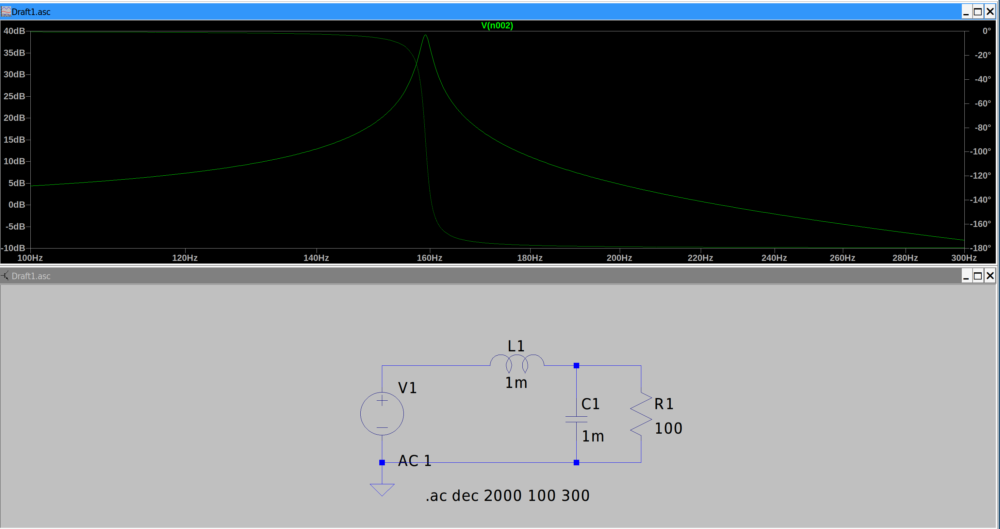

# tasks

- [x] 学习mount知识， 知道怎么才能看到windows上面的文件？经历了什么？还有docker里面涉及到的mount的概念
- [x] linux domain socket

# mounting in linux

Mounting does not copy, move, extract, or decompress files. It makes an existing filesystem accessible at a particular location in Linux's directory tree.

## how to access windows file?

### first, create a directory

``` bash
sudo mkdir -p /mnt/windows
```

``` bash
sudo mount -t ntfs3 /dev/nvme0n1p2 /mnt/windows
```

-t means type, specify the filesystem type

It basically tells the linux system: when a process accessed /mnt/windows , use the ntfs filesystem located on /dev/nvme0n1p2

what is ntfs3 nvme0n1p2 ?
what is a ntfs partition

## filesystem and virtual filesystem

a ssd may expose a sequence of logical blocks, but raw blocks don't inherently understand concepts like files, directories, filenames, permissions and so on. a filesystem defines how these concepts are represeneted using those blocks

common filesystem types include:

- ntfs: windows system drives
- ext4: linux system drives
- fat32: usb drives and EFI partitions
- exFAT: portable storage
- brtfs: linux system with advanced storage features
- tmpfs: memory-backed temporary filesystems
- overlays: docker image/container layers

however when writing a c program, the program doesn't care what filesystem type it is, it just call the same function. That is possible because linux provides an abstraction layer called VFS(virtual filesystem). each filesystem driver implements the operation needed by the vfs

## lsblk

``` bash
lsblk -f
```

list block devices

-f : show filesystem info

``` bash
wangj@thinkpad:docker-learning$ lsblk -f
NAME        FSTYPE   FSVER LABEL     UUID                                 FSAVAIL FSUSE% MOUNTPOINTS
loop0       squashfs 4.0                                                        0   100% /snap/core24/2124
loop1       squashfs 4.0                                                        0   100% /snap/bare/5
loop2       squashfs 4.0                                                        0   100% /snap/firefox/8863
loop3       squashfs 4.0                                                        0   100% /snap/firmware-updater/226
loop4       squashfs 4.0                                                        0   100% /snap/gnome-46-2404/164
loop5       squashfs 4.0                                                        0   100% /snap/gtk-common-themes/1535
loop6       squashfs 4.0                                                        0   100% /snap/mesa-2404/1839
loop7       squashfs 4.0                                                        0   100% /snap/snapd-desktop-integration/391
loop8       squashfs 4.0                                                        0   100% /snap/snap-store/1390
loop9       squashfs 4.0                                                        0   100% /snap/snap-store/1468
loop10      squashfs 4.0                                                        0   100% /snap/snapd/27738
nvme0n1
├─nvme0n1p1 vfat     FAT32 SYSTEM    D88D-22B2                             214.8M    16% /boot/efi
├─nvme0n1p2
├─nvme0n1p3 ntfs           Windows   4C5C8FC65C8FA8F2
├─nvme0n1p4 ntfs           Data      6658909658906699
├─nvme0n1p5 ntfs           WinRE_DRV 62C49118C490F011
└─nvme0n1p6 ext4     1.0             22529e00-7e1a-4bbb-b9f0-7ff80adf1594  117.1G    15% /
```

### nvme

non-volatile memory express: 非易失性存储存储器高速接口协议
volatile: easily chage or disappear
non-volatile memory : a storage that can still hold data after shutdown

nvme0n1 represents an NVMe storage device

nvme0n1p1 represents its secong partition

MOUNT POINT show where is a filesystem currently mounted

### mount it

``` bash
wangj@thinkpad:docker-learning$ sudo mount -t ntfs3 -o ro /dev/nvme0n1p3 /mnt/windows
```

`-o ro` means readonly, could also `-r`

## mount namespace

linux can give different groups of processes different mount namespaces. Each namespace has its own mount hierarchy

# Engslih Accumulation

- archive /ˈɑːr.kaɪv/ 


# 电力电子

resonanat converter

一般会选择在特征频率之上一点运行， 因为这样就能使用zvs

series / parallel



often used in the fluorescent bulbs

induction heating

to make the induction low when laying out the wire, make wire wide and put two wire close

# freertos

# unix domain socket

``` c
int socket(int domain, int type, int protocol);
```

domain: 通信域
常见通信域包括：
`
- AF_UNIX: 本机进程通信
- AF_INET: IPv4
- AF_INET6: IPv6
`
AF(address family)

type

- SOCK_STREAM
- SOCK_DGRAM
- SOCK_SEQPACKET

## unix socket address

big difference from TCP

tcp usually use address like ip-address:port, like `127.0.0.1:8000`

unix domain socket use file system path, like `/tmp/demo.sock`, however, the path here doesn't mean something will be written into the disk, it is only used for other processes to find this socket

in addition to pathname socket, there're another two type of socket:
1. unnamed socket, often seen in `socketpair()`
2. abstract namespace socket (unique in linux, the first character in the address is '\0', do not have a counterpart in the filesystem)

## some fact about file descriptor
file-descriptor 是进程内私有的
file-descriptor is different from the socket object in kernel
close(fd) only close the fd that held by the current process, instead of destroying the whole socket connection

## the symplified working procedure of the kernel

system call -> linux kernel : allocate scket-related kernel objcets, initialize AF_UNIX protocol state, create an associated file object, install a file descriptor, finally return fd

## use strace to look at the systemcall

``` bash
strace -e trace=socket,bind,listen,accept,connect,sendto,recvfrom,close,unlink ./server
```

TODO 解释

# emacs

how to find a definition?

run compile in emacs, and execute `grep -Rn 'something' /usr/include/`

or `rg --vimgrep 'something' /usr/include`

## difference between grep -r and grep -R

both -r and -R recurse the whole directory, but -r doesn't follow the symbolic link, while -R does

## how to stop the process in compilation mode?

C-c C-k

# c

the difference between strlen and sizeof

sizeof is an operator, while strlen is a function

for a string, strlen returns the length of the string, excluding the ending '\0', sizeof returns the sizeof the string, including the '\0'.

``` c
void perror(const char *s__);
/* Print a message describing the meaning of the value of errno.*/
```
 very useful
